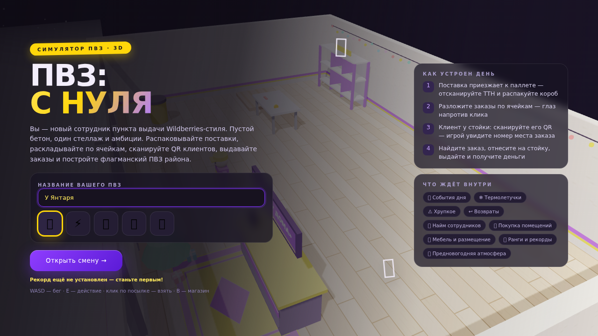

# ПВЗ: С Нуля 📦🦊

3D-симулятор сотрудника пункта выдачи Wildberries-стиля в уютной предновогодней атмосфере.
От пустого помещения у метро — до флагманского ПВЗ у ТЦ.



## Что внутри
- 🚚 Поставки, ТТН-скан, распаковка коробов, типы посылок: хрупкие / термо / брак
- 📱 **QR-первым**: сначала сканируется QR клиента на стойке — только потом открывается его заказ
  (стеллаж · ячейка) и загорается маяк над нужной полкой
- 🖱️ Посылка берётся **только по клику на неё** (или E рядом) — ищем глазами
- 🛋️ Магазин мебели **с установкой игроком**: призрак, кольцо валидности, поворот R
- 🏠 4 помещения с арендой/покупкой и планировками: метро → спальник → бизнес-центр → флагман у ТЦ
- 🎄 Декабрь: гирлянда, ёлка, падающий снег за витриной, «Предновогодний наплыв»
- 👷 Грузчик «Денис» распаковывает поставки сам
- 🏅 Ранги, рекорды (localStorage), события дня, фиксированный шаг симуляции 1/60

## Запуск
Открыть `index.html` напрямую или поднять любой статический сервер:
```bash
python3 -m http.server 8090
# → http://localhost:8090/
```

## Управление
WASD/стрелки — ходить · E — действие · клик по посылке — взять · R — повернуть мебель ·
B — магазин · Esc — пауза/отмена размещения · колесо — зум камеры. На телефоне: джойстик + «E».

## Стек
Three.js r128 (vendored, без CDN), чистый JS, без сборки. Тесты: `v03_test.py` (Playwright).
